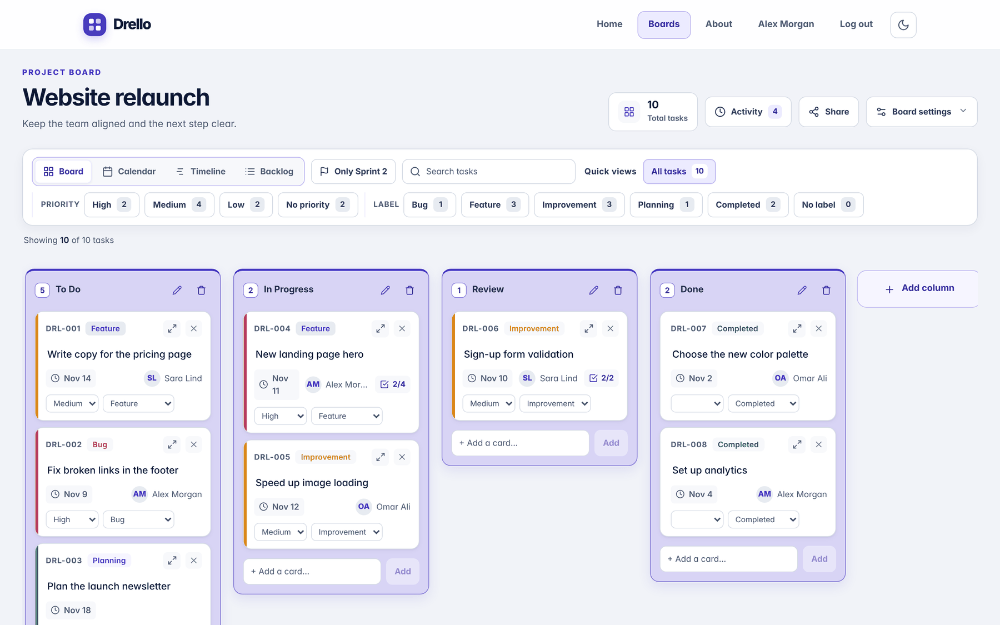
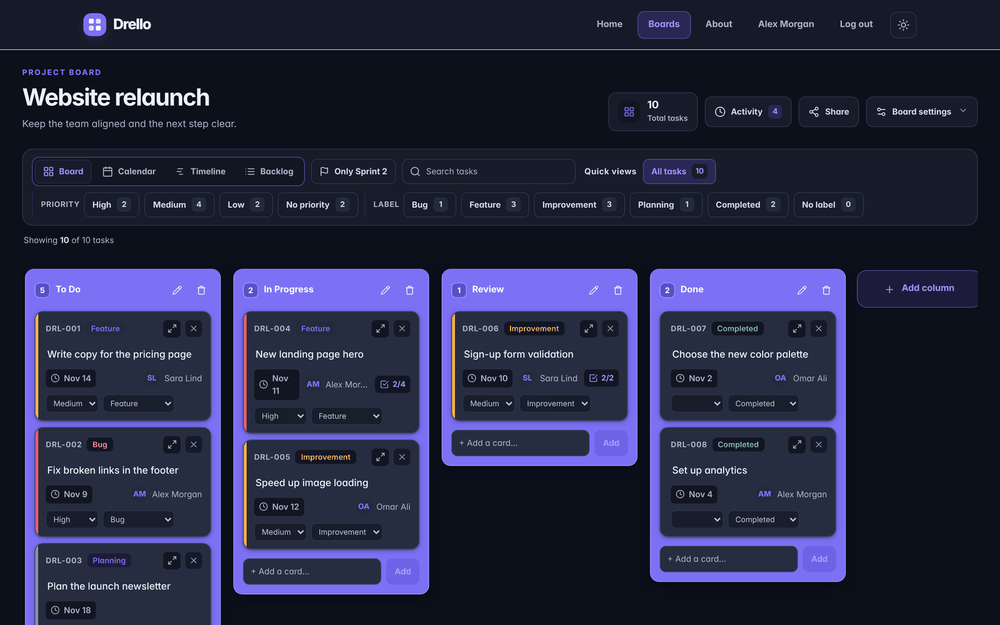
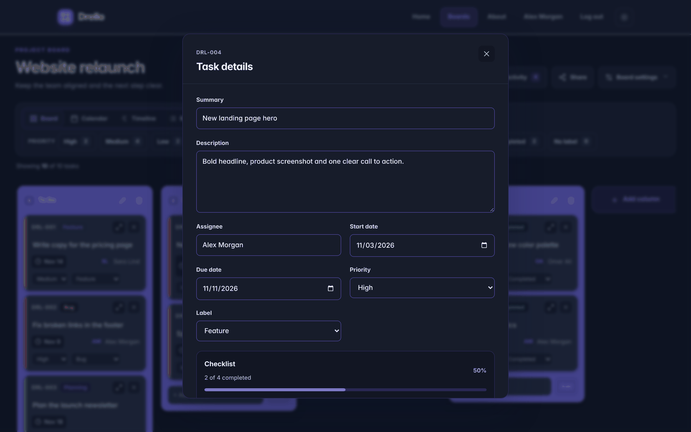
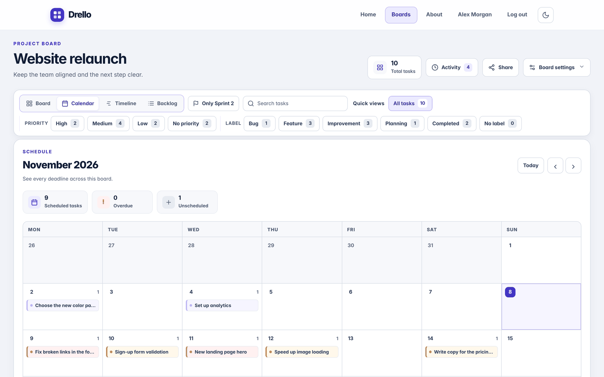
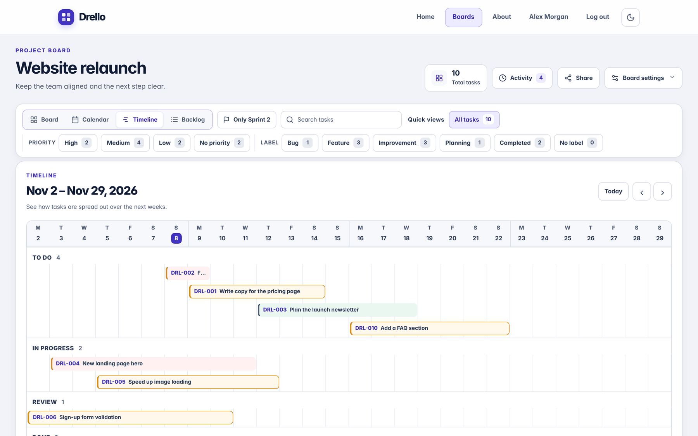
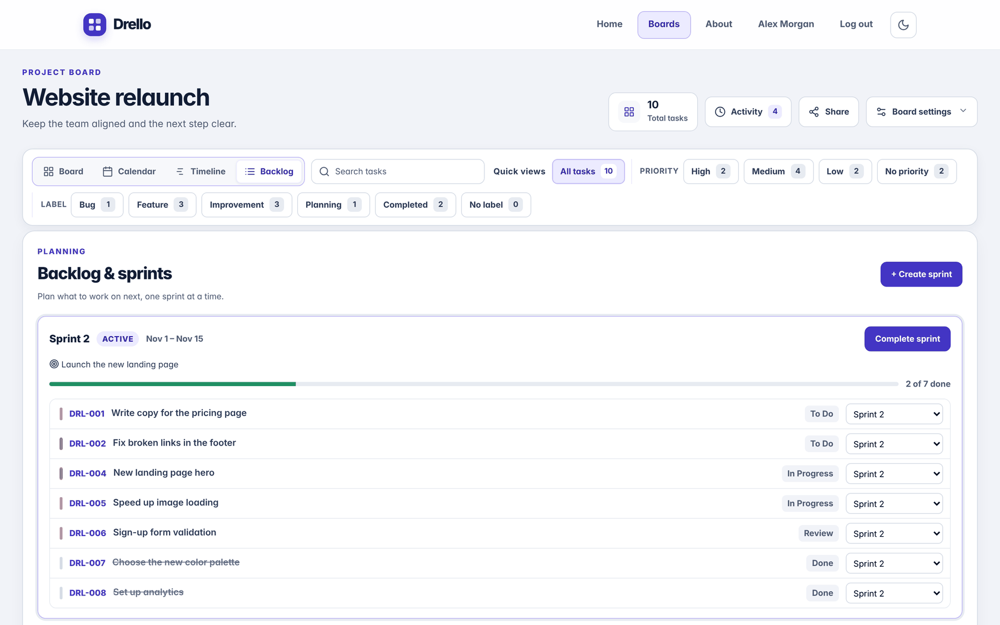
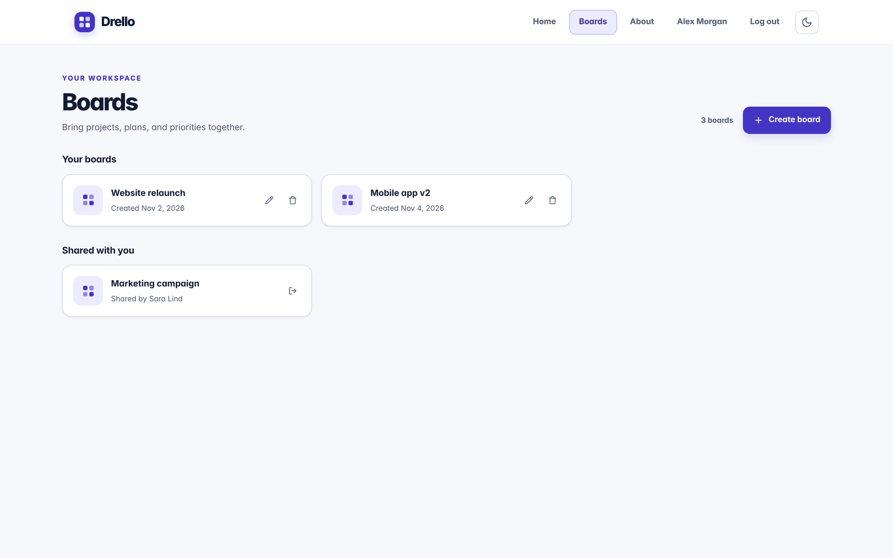

# Drello

A Trello-style project board, built as a fullstack app with **Angular**, **Node.js/Express** and **PostgreSQL**.

Plan work on boards with columns and cards, schedule it on a calendar and a timeline, run sprints, add your own fields, and let automations handle repetitive steps. Every user has their own account, and boards are saved in a real database.



## Screenshots

| Dark mode | Task details |
|---|---|
|  |  |
| **Calendar** | **Timeline** |
|  |  |
| **Backlog and sprints** | **Your boards** |
|  |  |

## Features

**Boards and tasks**
- Boards with columns and drag-and-drop cards
- Card details: description, assignee, start and due dates, priority, labels, checklists
- Search and quick filters by priority and label
- Activity history for every board

**Planning**
- **Calendar view** with every deadline on the board
- **Timeline view**: tasks as bars from start date to due date, four weeks at a time
- **Backlog and sprints**: plan, start and complete sprints, with progress and history

**Customizing**
- **Templates**: start a board from Basic, Scrum, Bug tracking or Content calendar, or save your own
- **Custom fields**: text, number, date, dropdown and checkbox fields per board
- **Automations**: rules like *"When a card is moved to Done, set the label to Completed"*

**Accounts**
- Sign up and log in, with each user only seeing their own boards
- Change password, forgot password with a single-use reset link, and delete account

**Teamwork**
- **Share boards** by email, with owner and member roles
- **Live updates**: when someone else changes a shared board, it updates on your screen (Server-Sent Events)

**Design**
- A design system with color tokens, light and **dark mode**
- SVG line icons that follow the theme
- Accessible: keyboard focus styles, WCAG AA contrast, ARIA labels, reduced-motion support
- App-styled dialogs that name what you're deleting

## Tech stack

| Part | Technology |
|---|---|
| Frontend | Angular 17, TypeScript, SCSS, Angular CDK (drag and drop) |
| Backend | Node.js, Express, TypeScript |
| Database | PostgreSQL |
| Security | bcrypt password hashing, JWT login tokens, owner checks on every request, rate limiting |
| Email | Nodemailer over SMTP |
| Tests | Jasmine and Karma |

## How it fits together

```
Angular app (localhost:4200)  →  Express API (localhost:3000)  →  PostgreSQL
        src/                          server/src/                  server/db/schema.sql
```

The app keeps a copy of your boards in the browser so it stays fast, and sends every change to the API, which saves it in PostgreSQL. The database is the source of truth: the latest version is loaded when you open the Boards page or a board.

## Getting started

**You need:** Node.js 22 (LTS) and PostgreSQL 15 or newer.

**1. Database:** create a database called `appdrello`, for example in pgAdmin.

**2. Server:**
```bash
cd server
cp .env.example .env      # then fill in your database password and a JWT_SECRET
npm install
npm run db:setup          # creates the tables
npm run dev               # API on http://localhost:3000
```
Check http://localhost:3000/api/health. It should say `"database": "connected"`.

**3. App** (in a second terminal, from the project folder):
```bash
npm install
npm start                 # app on http://localhost:4200
```

Open http://localhost:4200 and create an account.

### Email (optional)

"Forgot password" sends a reset link. Without email settings, the server prints the email in its terminal instead. To send real emails, fill in the `SMTP_*` settings in `server/.env`. Any SMTP provider works, for example Gmail with an App Password.

## Scripts

| Where | Command | What it does |
|---|---|---|
| project folder | `npm start` | Runs the Angular app with live reload |
| project folder | `npm test` | Runs the unit tests |
| project folder | `npm run build` | Production build into `dist/` |
| `server/` | `npm run dev` | Runs the API and restarts on changes |
| `server/` | `npm run db:setup` | Creates or updates the database tables |

## Project structure

```
src/app/
  auth/            Log in, sign up, account, forgot/reset password, guard, interceptor
  board/           The board page: columns, calendar, timeline, settings panels
  backlog/         Backlog and sprint planning
  card/            Cards and the task details dialog, plus the data models
  column/          Columns, and the Boards page (board-gallery)
  shared/          Dialogs, date helpers, theme, show/hide password
  board.service.ts Saving and syncing boards with the API
  api.service.ts   One method per API endpoint
server/
  db/schema.sql    The database tables
  src/routes/      API endpoints (auth, boards, board state, templates, ...)
  src/auth.ts      Login tokens and access checks
```

## Security notes

- Passwords are stored as **bcrypt hashes**, never as plain text
- Login uses signed **JWT** tokens; changing or resetting the password logs out other devices
- The server checks on every request that the board belongs to the logged-in user
- Reset links are random, single-use, expire after one hour, and only their hash is stored
- Login, sign-up and reset emails are **rate limited**
- "Forgot password" answers the same way whether or not an email has an account
- Secrets live in `server/.env`, which is never committed

## Roadmap

- Deploy online
